<p align="center">
  <a href="https://cmuller.ch"></a>
  <a href="https://www.linkedin.com/in/cedric-muller"></a>
  <a href="mailto:contact@cmuller.ch"></a>
</p>

<br>

## `~/stack`

<p align="center">
  
</p>

<br>

## `~/42`

<a href="https://profile.intra.42.fr/users/cedmulle"></a>

<p align="center">
  <a href="https://github.com/aceyzz/42-Piscine"></a>
  <a href="https://github.com/aceyzz/42-Cursus"></a>
  <a href="https://github.com/aceyzz/42-Specs"></a>
  <a href="https://github.com/aceyzz/42-Exam"></a>
</p>

<br>

## `~/certifications`

| ID | Certification | Issuer | Date | Status |
|:--|:--|:--|:--|:--|
| `RNCP7` | [IT Architecture Expert - Systems & Networks](https://www.credly.com/org/42/badge/rncp-niveau-7-expert-en-architecture-informatique-a.3) | 42 Network | 2026-04 | 🟢 `VERIFIED` |
| `RNCP6` | [App Design & Development - Web & Mobile](https://www.credly.com/org/42/badge/rncp-6-concepteur-developpeur-de-solutions-informat.3) | 42 Network | 2027 | 🟡 `ONGOING` |
| `42-CC` | [Digital Technologies Architect - Common Core](https://42.fr/en/the-program/software-engineer-degree/) | 42 Lausanne | 2024-10 | 🟢 `VERIFIED` |
| `SC-900` | [Security, Compliance & Identity Fundamentals](https://learn.microsoft.com/fr-fr/credentials/certifications/security-compliance-and-identity-fundamentals/?practice-assessment-type=certification) | Microsoft | 2024-12 | 🟢 `VERIFIED` |
| `DP-900` | [Azure Data Fundamentals](https://learn.microsoft.com/en-us/credentials/certifications/azure-data-fundamentals/?practice-assessment-type=certification) | Microsoft | 2024-08 | 🟢 `VERIFIED` |
| `AZ-900` | [Azure Fundamentals](https://learn.microsoft.com/en-us/credentials/certifications/azure-fundamentals/?practice-assessment-type=certification) | Microsoft | 2024-08 | 🟢 `VERIFIED` |

<br>

## `~/events`

```text
┌─ HACKATHON ── La Foire du Valais ──────────────── 2026-11 ─┐
│  track      Business Networking                            │
│  team       5 members                                      │
│  result     2nd place / 40                                 │
│  members    0xlowell · 0xOnyx · aceyzz · Jgm-h · uxornova  │
└────────────────────────────────────────────────────────────┘
```

```text
┌─ HACKATHON ── Audemars Piguet & Arianee ───────── 2025-11 ─┐
│  track      Innovation & Luxury Tech                       │
│  team       3 members                                      │
│  result     2nd place / 15                                 │
│  members    arnaudherman · jrandetdev · aceyzz             │
└────────────────────────────────────────────────────────────┘
```

```text
┌─ GAME JAM ── UPSI GameJam 4 ───────────────────── 2024-03 ─┐
│  theme      CONFINED                                       │
│  game       BrickWall                                      │
│  result     15th / 24                                      │
│  team       4 members                                      │
│  members    Rain36522 · alde-oli · DavePie · aceyzz        │
└────────────────────────────────────────────────────────────┘
```

```text
┌─ CTF ── 42 Lausanne ───────────────────────────── 2023-12 ─┐
│  rank       4th / 112 participants                         │
│  score      12'600 pts                                     │
│  field      73 challenges · avg 1'426 · median 3'019       │
│  scope      pwn · reverse · web · crypto · forensics       │
│             osint · stegano · privesc · misc               │
└────────────────────────────────────────────────────────────┘
```
